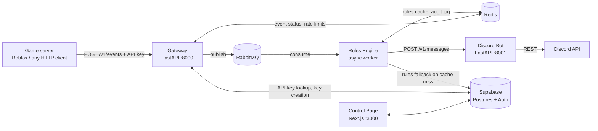

# Gateway Hub

[](https://github.com/vitalii-ye/gateway-hub/actions/workflows/ci.yml)
[](LICENSE)

**Gateway Hub turns in-game events into Discord messages.** A game server (e.g. a Roblox game) POSTs an event to a REST gateway with an API key; the event is queued, matched against user-defined rules, and delivered to the right Discord channel — *"a player bought VIP"* becomes a message in your community server within a second. Rules, projects, and API keys are managed from a web dashboard.

Built as a small event-driven microservice system: an ingestion API, a message queue, an async rules worker, and a thin Discord delivery service — each independently testable and deployable.

## Architecture



**Event lifecycle:** the gateway authenticates the API key (SHA-256 hash lookup), enforces a per-key rate limit, assigns an `event_id`, marks it `pending` in Redis, and publishes to RabbitMQ. The rules engine consumes the message, loads the guild's rules (Redis cache, Supabase fallback), evaluates conditions against the event payload, renders message templates, and calls the Discord bot service. Every outcome — `processed`, `ignored_no_match`, `failed_downstream`, … — is written back to Redis so clients can poll `GET /v1/events/{event_id}`, and an audit entry is appended per guild. Delivery failures are NACKed and retried; poison messages are ACKed as failed so they can't loop forever.

### Components

| Directory | What it is |
|---|---|
| [`gateway/`](gateway/README.md) | FastAPI ingestion API — API-key auth, rate limiting, event status, key creation |
| [`rules-engine/`](rules-engine/README.md) | RabbitMQ worker — rule evaluation, template rendering, audit logging |
| [`discord-bot/`](discord-bot/README.md) | FastAPI microservice that performs the actual Discord REST calls |
| [`control-page/`](control-page/) | Next.js dashboard — Supabase auth, manage projects, rules, and API keys |
| [`shared/`](shared/) | Config, DB client, and pydantic models shared by the Python services |
| [`docs/`](docs/roblox.md) | Integration guides (Roblox example with Luau snippet) |

**Stack:** Python 3.13 · FastAPI · RabbitMQ (aio-pika) · Redis · Supabase (Postgres, Auth, RLS) · Next.js + Tailwind (bun) · Docker Compose · pytest · ruff · GitHub Actions

## Quickstart

Prerequisites: Docker (with Compose), a [Supabase](https://supabase.com) project, and a Discord bot ([Discord developer portal](https://discord.com/developers/applications)) — you'll need its bot token and application (client) ID.

```bash
git clone https://github.com/vitalii-ye/gateway-hub.git
cd gateway-hub

# 1. Configure: fill in the Supabase and Discord values marked <like-this>
cp .env.example .env

# 2. Create the database tables — run the SQL from AGENTS.md ("Database schemas")
#    in the Supabase SQL editor: projects, rules, api_keys + RLS policies.

# 3. Boot the stack (use `docker-compose` if your Docker lacks the compose plugin)
docker compose up --build
```

Then:

- **Dashboard** — http://localhost:3000 : sign up, create a project with your Discord server (guild) ID, and use the **Add bot to server** button to install the bot into that guild (the panel shows live installed-status). Then add a rule and generate an API key.
- **Send an event:**

  ```bash
  curl -X POST http://localhost:8000/v1/events \
    -H "X-API-Key: gwh_..." \
    -H "Content-Type: application/json" \
    -d '{"event_type": "purchase", "data": {"item": "VIP", "username": "Builderman"}}'
  ```

  The response returns an `event_id`; poll `GET /v1/events/{event_id}` for its status. If a rule matches, the message appears in the configured Discord channel.
- RabbitMQ management UI: http://localhost:15672 (guest/guest).

## Testing

Each Python service has its own suite (unit tests for the rule/auth/config logic, API-level tests with faked Redis/RabbitMQ/Supabase — no infrastructure needed):

```bash
cd gateway && uv run pytest        # 59 tests
cd rules-engine && uv run pytest   # 40 tests
cd discord-bot && uv run pytest    # 10 tests
```

Lint/format with [ruff](https://docs.astral.sh/ruff/): `uvx ruff check .` from the repo root. CI runs lint, all three suites, and the frontend build on every push and PR.

## Status & roadmap

Working today: the full flow above, end to end, via Docker Compose — auth, rate limiting (429 + `Retry-After`), rule evaluation with template placeholders, Discord delivery, status tracking, audit logs, and the dashboard.

Planned:

- HMAC webhook signing (replay-window validation) for the ingestion endpoint
- More action types: role grants, rich embeds
- Audit log persistence in Postgres (Redis-only today)

## License

[MIT](LICENSE)
